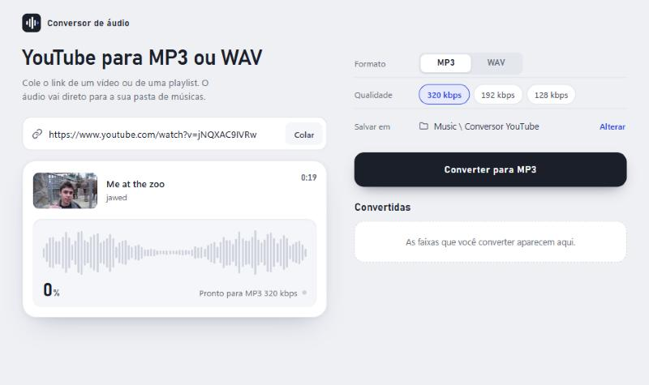

# Onda

Conversor de áudio do YouTube para **MP3** ou **WAV**, com uma interface clara que roda no seu próprio computador.



Cole o link de um vídeo ou de uma playlist, escolha o formato e clique em converter. A forma de onda se enche enquanto o áudio é baixado e convertido, e o arquivo vai direto para a sua pasta de músicas.

## O que ele faz

- MP3 em 320, 192 ou 128 kbps, ou WAV sem perdas
- Mostra capa, título, canal e duração antes de converter
- Baixa playlists inteiras
- Grava título e artista nas tags do arquivo
- Guarda um histórico das faixas, com botões para tocar e abrir a pasta
- Abre numa janela própria, sem barra de navegador, e fecha sozinho quando você fecha a janela

## Requisitos

- Windows 10 ou 11 (usa o Microsoft Edge para a janela)
- [Python 3.10+](https://www.python.org/downloads/)
- [ffmpeg](https://ffmpeg.org/)
- [yt-dlp](https://github.com/yt-dlp/yt-dlp)

## Instalação

```bash
git clone https://github.com/dudesltda/onda.git
cd onda
python -m pip install -U yt-dlp
winget install Gyan.FFmpeg
```

## Como abrir

```bash
pythonw conversor.py
```

Para abrir com dois cliques, crie um atalho na Área de Trabalho com o destino `pythonw.exe "C:\caminho\para\onda\conversor.py"` e use o `icone.ico` como ícone.

Os áudios vão para `Músicas\Conversor YouTube` por padrão. Dá para trocar a pasta em **Alterar**. O histórico e as preferências ficam em `%APPDATA%\ConversorYouTube`.

Se algum vídeo parar de baixar, quase sempre o YouTube mudou algo. Atualizar o yt-dlp resolve:

```bash
python -m pip install -U yt-dlp
```

## Como funciona

`conversor.py` sobe um pequeno servidor local (só a biblioteca padrão do Python mais o yt-dlp) em `127.0.0.1:8765` e abre `interface.html` numa janela do Edge em modo aplicativo. O yt-dlp baixa a melhor faixa de áudio e o ffmpeg converte para o formato escolhido.

## Uso responsável

Use apenas com conteúdo que você tem direito de baixar: suas próprias músicas, obras em domínio público ou com licença Creative Commons. Baixar conteúdo protegido sem permissão pode violar direitos autorais e os Termos de Serviço do YouTube.

## Licença

[MIT](LICENSE)
